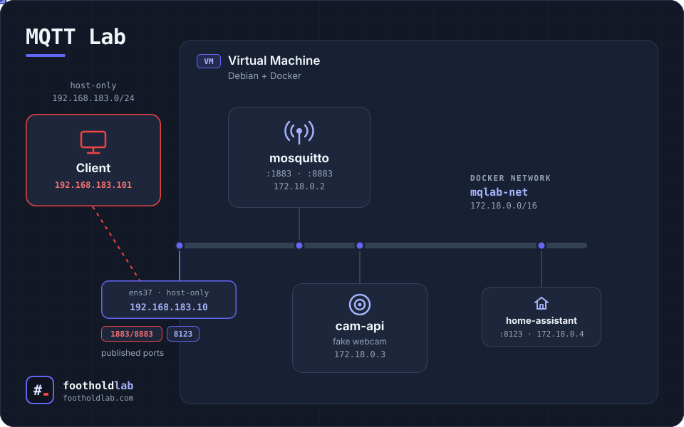

# MQTT Lab — Mosquitto access control


> **Companion article:** [MQTT broker access control: how far an attacker gets at each step](https://footholdlab.com)

> [!WARNING]
> Lab use only. Every credential in this repository is a fake lab value and is published on purpose. Change them if you deploy anything beyond an isolated lab, and never point this broker at a real home-automation installation.

## Table of contents

- [Introduction](#introduction)
- [Architecture](#architecture)
- [Mosquitto lab configuration](#mosquitto-lab-configuration)
- [Repository layout](#repository-layout)

---

## Introduction

A small, reproducible environment to test the security of home-automation (domotic) setups built around MQTT.

The first iteration focuses on the **Mosquitto broker**: four configuration scenarios, from a fully open broker to mutual TLS, each one closing what the previous one left open. The goal is the attack → mitigation → retry cycle: run the same commands against each scenario and compare what changes.

The lab is designed to grow. Home Assistant is already deployed as the "victim" consumer of the broker, and the fake device publisher is pluggable, so new devices, scenarios and attack paths can be added without rebuilding the environment.

---

## Architecture



### Virtual machines

Two VMs on VMware Workstation, connected through a host-only network (`192.168.183.0/24`).

| VM | OS | Resources | Network | Role |
|---|---|---|---|---|
| `mq-lab` | Debian 13 (minimal, no GUI) | 2 vCPU, 4 GB RAM, 20 GB disk | `ens37` host-only, static `192.168.183.10`<br>`ens33` NAT, only for pulls, disconnected afterwards | Docker host |
| Client | Kali or Parrot | — | host-only, `192.168.183.101` | Attacker / MQTT client |

The attacker runs on a separate VM on purpose: connections from the Docker host itself would appear in the broker logs as the bridge gateway, while an external client is logged with its real IP.

Once the lab is built, the NAT adapter of `mq-lab` is disconnected, so the broker has no Internet access.

### Docker

Three containers on a dedicated bridge network:

| Service | Image | Internal IP | Published on `192.168.183.10` | Role |
|---|---|---|---|---|
| `mosquitto` | `eclipse-mosquitto:2` | `172.18.0.2` | `1883` (all scenarios), `8883` (scenario 03) | The broker under test |
| `cam-api` | built from [`cam-api/`](cam-api/) | `172.18.0.3` | — (internal only) | Fake IP camera that publishes telemetry built with python |
| `homeassistant` | `ghcr.io/home-assistant/home-assistant:stable` | `172.18.0.4` | `8123` | Broker consumer, kept for future tests |

- **Network:** bridge `mqlab-net` (interface `br-mqlab`, subnet `172.18.0.0/16`). Containers reach each other by service name (`mosquitto`).
- **Published ports** are bound only to the host-only IP, never to `0.0.0.0`.
- **Hardening** shared by all services: `no-new-privileges`, `cap_drop: ALL`, memory limits, log rotation. Mosquitto and `cam-api` run as non-root users with a read-only root filesystem (Home Assistant's official image does not support it).
- **Healthcheck:** Mosquitto is checked by subscribing to `$SYS/broker/uptime` with the `svc_health` account; `cam-api` and Home Assistant start only when the broker is healthy.

All parameters (paths, IPs, ports, users, image tags, limits) live in the `.env` files; the compose file contains no hard-coded values.

### Host directories

| Path on `mq-lab` | Content | In git |
|---|---|---|
| `/srv/docker-conf/lab-mosquitto/` | This repository | Yes |
| `/srv/lab-mosquitto/data/` | `mosquitto.db` (persistence) — owner `1883:1883` | No |
| `/srv/lab-mosquitto/log/` | `mosquitto.log` — owner `1883:1883` | No |
| `/srv/lab-mosquitto/ha-config/` | Home Assistant configuration | No |
| `/srv/lab-mosquitto/pki/` | Lab CA and client certificates (scenario 03) | No |

### Installation

On `mq-lab`, with Docker CE and the Compose v2 plugin installed from Docker's official repository:

```bash
sudo git clone https://github.com/footholdlab/MQTT_Lab.git /srv/docker-conf/lab-mosquitto
cd /srv/docker-conf/lab-mosquitto

sudo mkdir -p /srv/lab-mosquitto/{data,log,pcap,ha-config}
sudo chown -R 1883:1883 /srv/lab-mosquitto/data /srv/lab-mosquitto/log

docker run --rm eclipse-mosquitto:2 id   # must return uid=1883; otherwise fix MOSQ_UID/MOSQ_GID in .env
```
---

## Mosquitto lab configuration

### Scenarios

Each scenario is a directory under [`conf/`](conf/). A symlink, `conf/active_conf`, selects which one is mounted (read-only) as `/mosquitto/config`.

| # | Directory | What it changes | What it leaves open |
|---|---|---|---|
| 00 | [`conf/00-basic/`](conf/00-basic/) | Open broker: `listener 1883 0.0.0.0`, `allow_anonymous true`, no ACL | Everything: anonymous `#` subscription returns the full topic tree, including the retained camera credential |
| 01 | [`conf/01-acl/`](conf/01-acl/) | Anonymous access disabled, password file, per-user ACL | ACL is over-broad (`svc_health` and `svc_ha` read `cam/#`); retained messages still allowed |
| 02 | [`conf/02-acl-patterns/`](conf/02-acl-patterns/) | Least-privilege ACL, `pattern readwrite cam/%c/#`, `retain_available false` | Identity is the client ID, which the client declares itself |
| 03 | [`conf/03-tls-mutual/`](conf/03-tls-mutual/) | Single listener on `8883` with mutual TLS, `use_identity_as_username true`, ACL with `%u` (certificate CN) | A valid certificate from the same CA still connects, but is confined to its own subtree |

Supporting files per scenario:

| Scenario | Environment file | Compose files | `cam-api` client ID | Extra files |
|---|---|---|---|---|
| 00, 01 | [`.env-00-01`](.env-00-01) | [`compose.yml`](compose.yml) | `cam-api-01` | `conf/01-acl/passwd` |
| 02 | [`.env-02-03`](.env-02-03) | [`compose.yml`](compose.yml) | `frontdoor` | `conf/02-acl-patterns/passwd` |
| 03 | [`.env-02-03`](.env-02-03) | [`compose.yml`](compose.yml) + [`compose-03.yml`](compose-03.yml) | `frontdoor` (CN of its certificate) | Certificates generated by [`scripts/gen-pki-03.sh`](scripts/gen-pki-03.sh) |

The fake camera source is [`cam-api/publisher.py`](cam-api/publisher.py), which supports all scenarios (retain switch via `CAM_RETAIN`, TLS via `MQTT_TLS`). [`publisher-00-01.py`](cam-api/publisher-00-01.py) and [`publisher-02.py`](cam-api/publisher-02.py) are kept as references of the code used in earlier scenarios.

### Switching scenarios

The persistence database is part of the scenario state. Whether it is deleted or kept decides if retained messages from the previous scenario survive.

**00 → 01** (keep `mosquitto.db`: the retained credential published in 00 survives, which is what scenario 01 demonstrates):

```bash
cd /srv/docker-conf/lab-mosquitto
docker compose down
cp .env-00-01 .env
ln -sfn 01-acl conf/active_conf
docker compose up -d
```

**→ 02** (clean database):

```bash
docker compose down
sudo rm -f /srv/lab-mosquitto/data/mosquitto.db
cp .env-02-03 .env
ln -sfn 02-acl-patterns conf/active_conf
docker compose up -d --build
```

**→ 03** (clean database, generate certificates once, add the compose overlay):

```bash
docker compose down
sudo rm -f /srv/lab-mosquitto/data/mosquitto.db
sudo ./scripts/gen-pki-03.sh          # first time only
cp .env-02-03 .env
ln -sfn 03-tls-mutual conf/active_conf
docker compose -f compose.yml -f compose-03.yml up -d
```

Starting from scratch (scenario 00) is the same cycle with `.env-00-01` and `ln -sfn 00-basic conf/active_conf`.

### Scenario-specific notes

- **Password files (01, 02):** generated with the tool shipped in the Mosquitto image, for example:

  ```bash
  docker run --rm -v ./conf/01-acl:/c eclipse-mosquitto:2 \
    mosquitto_passwd -b -c /c/passwd svc_cam 'S3cret-cam'
  ```

- **Scenario 03:**
  - [`scripts/gen-pki-03.sh`](scripts/gen-pki-03.sh) creates the lab CA in `/srv/lab-mosquitto/pki/` (never mounted into the broker) and issues certificates for the server, `frontdoor`, `svc_ha`, `svc_health` and `client`. The last one is the attacker: a valid certificate signed by the same CA.
  - Only the files the broker needs are copied to `conf/03-tls-mutual/certs/`. Private keys must not be committed.
  - [`compose-03.yml`](compose-03.yml) publishes `8883`, moves the healthcheck to mTLS and mounts the `frontdoor` certificate into `cam-api`. Port `1883` stays published but nothing listens behind it.
  - Home Assistant must be reconfigured manually (MQTT integration → port `8883`, empty user and password, CA plus `svc_ha` certificate and key).

### Verifying the active scenario

```bash
readlink conf/active_conf
docker compose ps                       # mosquitto must be "healthy"
docker compose logs -f mosquitto        # connections show the client's real IP
sudo tcpdump -i br-mqlab -w /srv/lab-mosquitto/pcap/<scenario>.pcap port 1883 or port 8883
```

---

## Repository layout

```
.
├── compose.yml              Base stack (scenarios 00-03)
├── compose-03.yml           Overlay for scenario 03 (mTLS)
├── .env-00-01               Parameters for scenarios 00 and 01
├── .env-02-03               Parameters for scenarios 02 and 03
├── cam-api/                 Fake IP camera (Dockerfile + publisher)
├── conf/
│   ├── 00-basic/
│   ├── 01-acl/
│   ├── 02-acl-patterns/
│   ├── 03-tls-mutual/
│   └── active_conf -> <scenario>    (created locally, not in git)
├── scripts/gen-pki-03.sh    Lab PKI for scenario 03
└── docs/mqtt-lab.svg        Architecture diagram
```

## License

[MIT](LICENSE) — Foothold Lab · [footholdlab.com](https://footholdlab.com)
